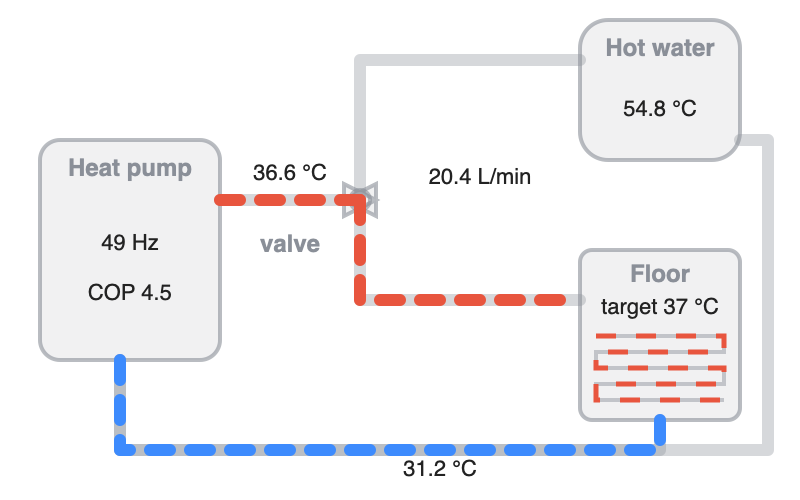
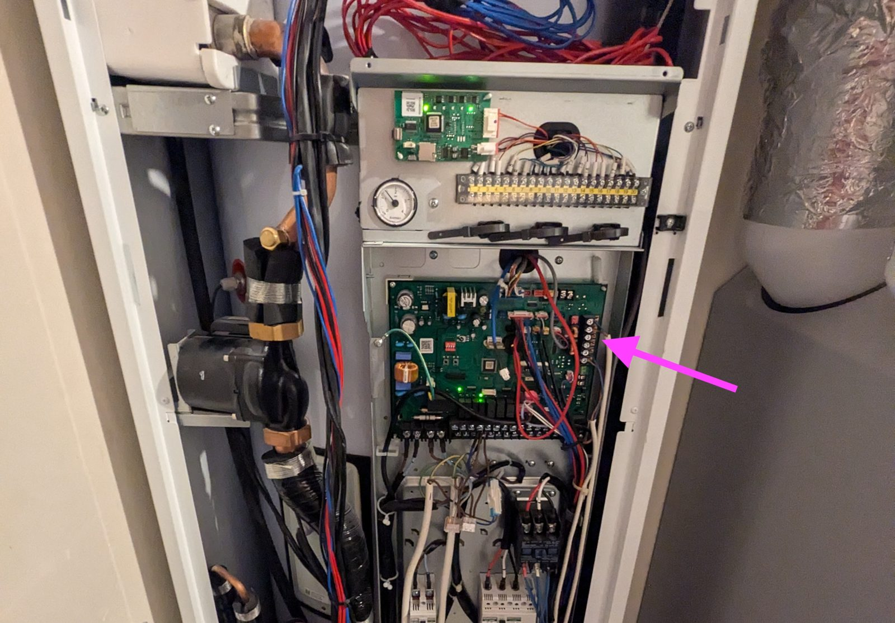

# Samsung EHS heat pump in Home Assistant (ESPHome + M5Stack)

Local control and monitoring of a Samsung EHS air-to-water heat pump from Home Assistant, using a
€30 ESP32 board on the unit's RS485 (NASA) bus. No cloud, no SmartThings.

Tested on **Samsung EHS Mono ClimateHub AE260RNWSGG** (9 kW heating, R-32, 254 L DHW tank, 2022).
Other NASA-protocol EHS units (Mono, Split, ClimateHub) should work the same way; message support
can differ per model.

Built on [omerfaruk-aran/esphome_samsung_hvac_bus](https://github.com/omerfaruk-aran/esphome_samsung_hvac_bus) -
all the protocol work is theirs. This repo adds a working config for this unit, extra NASA sensors
with verified scaling, and Home Assistant automations and dashboard cards around it.

## What you get

- Space heating and domestic hot water (DHW) control: power, targets, DHW mode, presets
- Flow / return temperature, flow rate, 3-way valve position, defrost, compressor frequency
- Heat output (W and lifetime Wh) next to the outdoor unit's power → **live and daily COP**
- Automations:
  - DHW off at night, back on 75 min before the earliest phone alarm, heat-pump only (no booster),
    with space heating paused until the tank is hot
  - **Solar surplus**: when the home battery is full and you export, heat the tank to 55 °C and
    raise the floor water by 5 °C, then restore everything
  - 15-minute DHW boost script that pauses space heating and restores it afterwards
- An animated water-flow diagram card (heat pump → valve → tank or floor)

## Hardware

| Part | Notes |
|---|---|
| [M5Stack ATOM Lite](https://docs.m5stack.com/en/core/atom_lite) (ESP32) | any ESP32 works; pins below are for the ATOM |
| [M5Stack ATOM Tail485](https://docs.m5stack.com/en/atom/tail485) | RS485 transceiver that the ATOM plugs into; has screw terminals for A/B and a DC input |
| 2-core cable | twisted pair, short run to the indoor unit's terminal block |
| Power | from the heat pump itself: the indoor unit's board has a DC output, clearly labelled once the front cover is off, wired to the Tail485's DC input. Check that the labelled voltage is within the Tail485's input range. (A USB-C 5 V adapter on the ATOM also works for bench testing.) |

UART pins (ATOM + Tail485): `tx_pin: GPIO26`, `rx_pin: GPIO32`, 9600 baud, even parity.

### Wiring

Connect the Tail485 **A / B** to the heat pump's **F1 / F2** communication terminals (the NASA bus
between indoor and outdoor unit), as described in the
[component's README](https://github.com/omerfaruk-aran/esphome_samsung_hvac_bus). If you see no
data in the ESPHome logs, swap A and B.

On the AE260RNWSGG both are on the **vertical terminal strip at the right edge of the main board**
(arrow), behind the front cover: **F1/F2** (bus) and the **DC +/-** output that powers the ATOM.
The terminals are labelled on the board.

> ⚠️ The indoor unit contains mains voltage. Switch the heat pump off at the breaker before opening
> it, and only connect to the low-voltage communication terminals. If in doubt, ask your installer.
> You do this at your own risk.

## Install

1. **ESPHome**: copy `esphome/samsung-ehs.yaml` to your ESPHome config folder, create
   `secrets.yaml` from `esphome/secrets.yaml.example`, flash the ATOM over USB the first time,
   then OTA. Keep `friendly_name: Heat Pump` - the HA files below expect `sensor.heat_pump_*`.
   On a low-RAM host (Home Assistant Yellow/Green) uncomment `compile_process_limit: 1` and stop
   memory-hungry add-ons while compiling.
   The component is pinned to the commit tested here (`fe08cb0`, 2026-09-30). To update, change
   the `@...` ref in `external_components` deliberately and re-test.
2. **Home Assistant**: copy `homeassistant/packages/samsung_ehs.yaml` to `/config/packages/`
   (enable packages, see the file header) and change the lines marked `CHANGE ME`
   (phone alarm sensors, inverter grid/battery/PV sensors). Restart HA.
3. **Dashboard** (optional): copy `dashboard/flow/*.svg` to `/config/www/hp_flow/`, then paste
   `dashboard/flow-card.yaml` and `dashboard/tiles.yaml` into a dashboard.

## Findings worth knowing

- Starting DHW earlier does not stop the booster: in **Standard** mode it joins ~20 min after
  the start, whatever the tank temperature. **Eco** keeps it off. Details in
  [docs/nasa-messages.md](docs/nasa-messages.md).
- **Eco alone leaves the tank lukewarm** when space heating also wants heat: the controller gives
  DHW only ~10 minutes, then the 3-way valve goes back to space heating and stays there (tank
  33 → 36.7 °C, then nothing). In Standard the booster quietly finished the tank meanwhile. The
  morning automation therefore pauses space heating until the tank is within 1 °C of target.
- After the night switch-off the 254 L tank lost about 1 °C per hour (43 → 33 °C by 05:15).
  With the valve on the tank, the heat pump alone added ~3.7 °C in 10 min at ~0 °C outside.
- Raising the space-heating water target by 5 °C only raised the compressor's draw by a few
  hundred watts at first - a floor slab takes a long time to warm up. Heating the DHW tank in
  Power mode is a much better sink for a few kW of solar surplus.
- Lifetime COP is shown on the unit's own counters: heat output total (`0x4427`) ÷ outdoor
  cumulative energy.

## Credits & license

- Protocol and ESPHome component: [omerfaruk-aran/esphome_samsung_hvac_bus](https://github.com/omerfaruk-aran/esphome_samsung_hvac_bus)
  (originally [lanwin/esphome_samsung_ac](https://github.com/lanwin/esphome_samsung_ac)).
- This repo: MIT, see [LICENSE](LICENSE). Not affiliated with Samsung.
